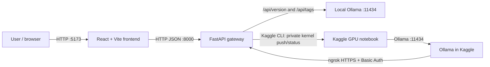
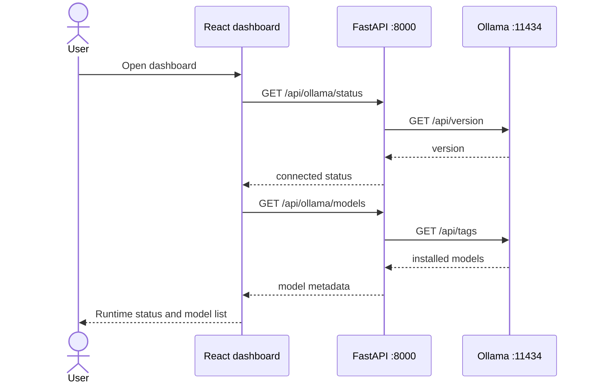
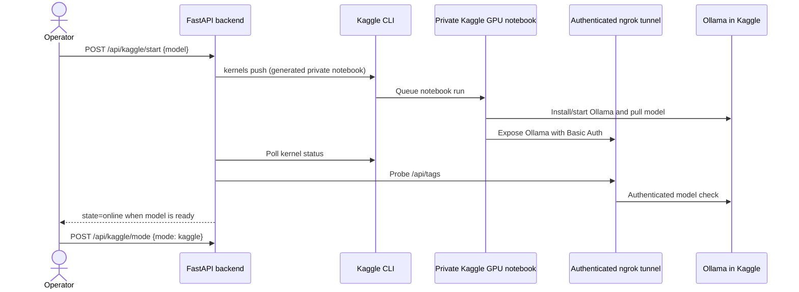

# NEXUS AI — Terminal commands and workflows

This guide covers the integrated application in the repository-root `backend/`
and `frontend/` folders. The older `nexus-ai/` directory is a separate UI
prototype; do not use it to start the integrated app.

## 1. Requirements

- Python 3.10+
- Node.js 20+ and npm
- Ollama for local inference
- Kaggle/ngrok are optional; they are required only for Kaggle cloud mode

Open three PowerShell terminals at the repository root when using local Ollama:
one for Ollama (only if it is not already running), one for the API, and one for
the frontend.

## 2. Start local Ollama

If the Ollama desktop app is already running, skip `ollama serve`.

```powershell
ollama serve
```

In another terminal, download and inspect a model:

```powershell
ollama pull llama3.2
ollama list
Invoke-RestMethod http://127.0.0.1:11434/api/version
```

The expected local endpoint is `http://127.0.0.1:11434`.

## 3. Configure and run the backend

From the repository root:

```powershell
cd backend
py -3 -m venv .venv
.\.venv\Scripts\Activate.ps1
python -m pip install --upgrade pip
python -m pip install -r requirements.txt
Copy-Item .env.example .env
```

Only run `Copy-Item` when `.env` does not already exist. Edit `backend/.env` if
you need non-default values; never share or commit that file.

If PowerShell blocks activation:

```powershell
Set-ExecutionPolicy -Scope Process -ExecutionPolicy Bypass
.\.venv\Scripts\Activate.ps1
```

Run the API:

```powershell
uvicorn app.main:app --reload --host 127.0.0.1 --port 8000
```

Keep this terminal open. Check the backend from another terminal:

```powershell
Invoke-RestMethod http://127.0.0.1:8000/api/health
Invoke-RestMethod http://127.0.0.1:8000/api/ollama/status
Invoke-RestMethod http://127.0.0.1:8000/api/ollama/models
```

Interactive API reference: <http://127.0.0.1:8000/docs>.

## 4. Configure and run the frontend

In a second PowerShell window at the repository root:

```powershell
cd frontend
npm ci
npm run dev
```

Open <http://127.0.0.1:5173/>. Keep the Vite terminal open. The default API
address is `http://127.0.0.1:8000`.

To point the browser app at a different backend, create `frontend/.env.local`:

```env
VITE_API_BASE_URL=http://127.0.0.1:8000
```

Restart Vite after editing the file.

## 5. Kaggle cloud mode (optional)

The dashboard includes a Kaggle GPU panel. Cloud mode is optional; local Ollama
continues to work without Kaggle or ngrok credentials.

### 5.1 Prepare credentials

1. Create a Kaggle API token in Kaggle account settings.
2. Reserve an ngrok static domain and obtain an ngrok auth token.
3. Add `NGROK_TOKEN` and `TUNNEL_PASSWORD` to Kaggle Notebook Secrets.
4. In `backend/.env`, set the Kaggle credentials/domain and the matching tunnel
   password:

```env
KAGGLE_USERNAME=your_kaggle_username
KAGGLE_KEY=your_kaggle_api_token
KAGGLE_KERNEL_NAME=nexus-ollama-server
NGROK_DOMAIN=your-reserved-domain.ngrok-free.app
TUNNEL_USER=nexus
TUNNEL_PASSWORD=replace-with-a-long-random-password
```

The local `TUNNEL_PASSWORD` must match the Kaggle Notebook Secret of the same
name. Never commit `.env`, Kaggle/ngrok tokens, or tunnel passwords. Restart the
backend after changing `.env`.

### 5.2 Start and switch runtime

The panel can start a Kaggle notebook and switch the model-list/status requests
to it after the state reaches `online`. Equivalent backend API requests:

```powershell
# Read the current Kaggle state
Invoke-RestMethod http://127.0.0.1:8000/api/kaggle/status

# Push/start a private Kaggle notebook with the selected model
$body = @{ model = "llama3.2" } | ConvertTo-Json
Invoke-RestMethod -Method Post `
  -Uri http://127.0.0.1:8000/api/kaggle/start `
  -ContentType "application/json" `
  -Body $body

# Switch requests to Kaggle only after its state is "online"
$body = @{ mode = "kaggle" } | ConvertTo-Json
Invoke-RestMethod -Method Post `
  -Uri http://127.0.0.1:8000/api/kaggle/mode `
  -ContentType "application/json" `
  -Body $body

# Return requests to local Ollama
$body = @{ mode = "local" } | ConvertTo-Json
Invoke-RestMethod -Method Post `
  -Uri http://127.0.0.1:8000/api/kaggle/mode `
  -ContentType "application/json" `
  -Body $body
```

Starting Kaggle pushes the generated private notebook. Kaggle may queue the
kernel while GPU availability is pending. Status progresses through `idle`,
`pushing`, `queued`, `starting`, and `online` (or `stopped`/`error`). Selecting
Kaggle mode is only allowed once it is online.

## 6. Build and stop

Build the frontend in its terminal:

```powershell
cd frontend
npm run build
```

Compile-check backend Python files in the activated backend environment:

```powershell
cd backend
python -m compileall -q app
```

Stop development servers with `Ctrl+C` in their respective terminals. Exit the
Python virtual environment with:

```powershell
deactivate
```

## 7. Runtime architecture



The browser calls the FastAPI gateway. The backend uses local Ollama by default
and routes status/model requests through the authenticated tunnel when Kaggle
mode is selected.

## 8. Local request flow



## 9. Kaggle launch flow



## 10. API route and data summary

| Method | Route | Request | Result |
|---|---|---|---|
| `GET` | `/api/health` | — | Backend service health |
| `GET` | `/api/ollama/status` | — | `connected`, `version`, `mode`, `message` |
| `GET` | `/api/ollama/models` | — | Model name, size, digest, family, and quantization |
| `GET` | `/api/kaggle/status` | — | Kaggle state, selected mode, model, and endpoint metadata |
| `POST` | `/api/kaggle/start` | `{"model":"llama3.2"}` | Push/start a private Kaggle notebook |
| `POST` | `/api/kaggle/mode` | `{"mode":"local"}` or `{"mode":"kaggle"}` | Select active Ollama runtime |

## 11. Troubleshooting

- **Ollama shows Offline:** confirm the Ollama app or `ollama serve` is running;
  test `Invoke-RestMethod http://127.0.0.1:11434/api/version`.
- **Model list is empty:** run `ollama pull llama3.2`, then refresh the page.
- **Frontend cannot reach API:** confirm the backend is running on port `8000`
  and that `VITE_API_BASE_URL` is correct.
- **PowerShell activation is blocked:** use the process-scoped execution policy
  command in section 3; it does not change the machine-wide policy.
- **Kaggle does not start:** check `backend/.env`, Kaggle account/token access,
  Kaggle Notebook Secrets, ngrok domain, and Kaggle kernel logs. Never paste
  credential values into logs or issue reports.

## Related documentation

- [English README](README.en.md)
- [O‘zbekcha README](README.uz.md)
- [MIT License](LICENSE)